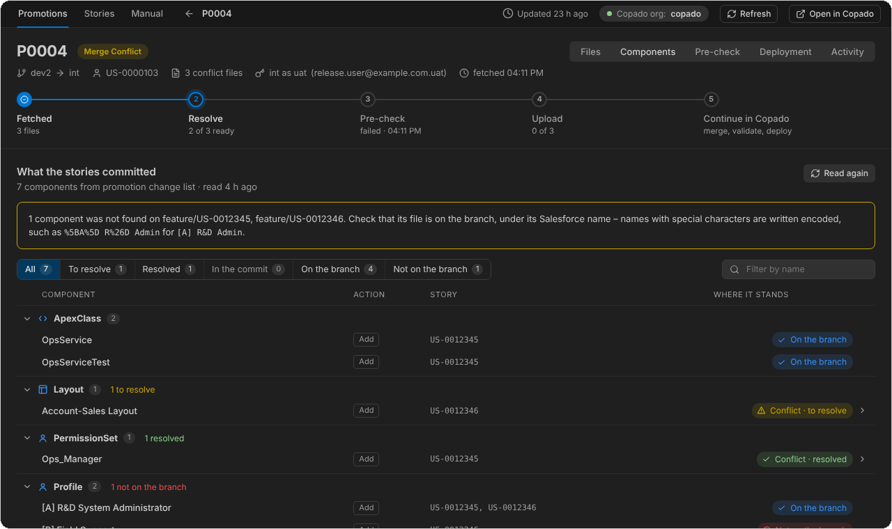
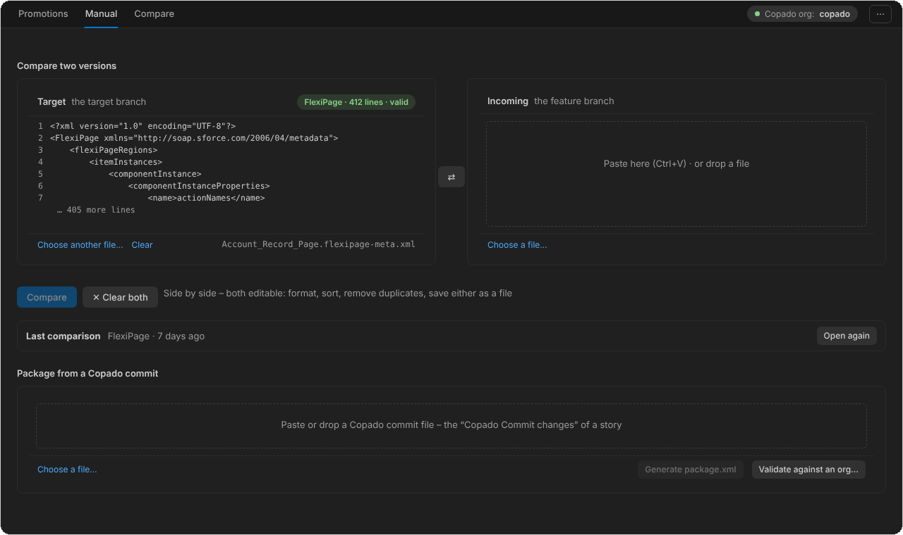

<p align="center">
  
</p>

<h1 align="center">Copado Release Assistant</h1>

<p align="center">
  Resolve Copado promotion conflicts and validate user stories — without leaving VS Code.
</p>

<p align="center">
  <a href="https://github.com/nikeshvarma/Copado-Release-Assistant/releases/latest"></a>
  <a href="https://github.com/nikeshvarma/Copado-Release-Assistant/actions/workflows/test.yml"></a>
  <a href="LICENSE"></a>
  <a href="https://code.visualstudio.com/"></a>
  <a href="https://developer.salesforce.com/tools/salesforcecli"></a>
</p>

<p align="center">
  <a href="#features">Features</a> ·
  <a href="#getting-started">Getting started</a> ·
  <a href="#safety">Safety</a> ·
  <a href="#configuration">Configuration</a> ·
  <a href="#development">Development</a>
</p>


## Features

### Promotion conflicts, resolved without losing anything

Open a promotion that stopped on a merge conflict — by its number, a user story or its Copado link, in the **Promotions** tab's one box — and every conflicted file is fetched at once. Metadata is merged for you to review — never resolved on its own — and code keeps its conflict blocks for VS Code's own buttons. Upload all resolutions in one step, read back from Copado, with undo.


### See what the stories committed

The **Components** tab lists every component the promotion's stories committed, grouped by type: its action, its story and where it stands — a conflict to resolve or resolved, on the branch, or not on the branch after a pre-check. Filter by what needs doing or by name; a conflict opens its file.



### A merge editor built for Salesforce metadata

Metadata XML repeats the same lines everywhere, so line-by-line diffs pair the wrong blocks. The merge editor lines up **element by element**, against the target exactly as it is: what the feature branch added, what you changed, and what was removed — struck through, where it was. A block moved within an ordered list is what it is to the file: removed from its place and added at the new one, each row saying where the other is, and one click puts it back. Every action is undone with `Ctrl+Z`, and nothing is merged behind your back: what the feature branch removed or changed is always marked.

Entries are matched by what identifies them — a field permission by its field, a page action by its value, a flow element by its name — including lists from the newest releases, such as Agentforce agents and topics. What Salesforce reads the same is not shown as a change: an entry's fields in another order, `<x/>` for `<x></x>`, `&#38;` for `&amp;`, other line endings, a flow's elements in another order. A flow element only dragged in Flow Builder is one quiet *Moved on the canvas* row. Unchanged runs fold away, and unsaved work is kept as a draft if the editor closes.

Duplicates and broken XML are caught as you type. A duplicate entry is marked on its own lines with the line it repeats, and removed with one click; identical duplicates are taken out when the merge is prepared. Invalid XML is underlined exactly where it breaks.


### Validate before Copado does

Check a promotion's resolutions, or a user story straight from its feature branch, against the target org — check-only, nothing deploys. Errors point to the right line, with suggested fixes.


### Manual merge, with or without Copado

The **Manual** tab — always there — merges two versions pasted from Copado's conflict screen, or any two files, in the same merge editor, then copies the result back. It also builds a `package.xml` from a Copado commit file. Right-click an XML file → **Merge in Release Assistant…** to start from it.



### And more

- **Branch conflicts** between two git branches, with the merge-base — nothing checked out or changed.
- **Checks as you type** for duplicates and deploy-breaking metadata rules.
- **Formatting** in the order Salesforce writes metadata, so diffs show only real changes.
- **Team guardrails** in `copado-policy.json`: which orgs, which test levels, per environment.

## Getting started

**Requirements:** VS Code 1.90 or later, the [Salesforce CLI](https://developer.salesforce.com/tools/salesforcecli) v2 with your orgs logged in, and git 2.38 or later for branch conflicts.

1. Download the `.vsix` from the [latest release](https://github.com/nikeshvarma/Copado-Release-Assistant/releases/latest) and install it:
   ```bash
   code --install-extension copado-release-assistant-3.10.2.vsix
   ```
2. Open your Salesforce project folder.
3. Run **Copado: Open Settings** and set **Copado org** — the Salesforce CLI alias of the org where Copado runs.
4. Run **Copado: Open Release Assistant**.

Without a Copado org, the **Manual** tab works on its own.

## Safety

- **Nothing deploys.** Every validation is check-only.
- **Git is read-only.** No checkout, merge, commit or push.
- **Copado is written only when you confirm** — uploading resolutions and setting a promotion's status.
- **No passwords.** Orgs come from the Salesforce CLI; repository tokens stay in VS Code's encrypted storage.
- **Working files stay in `.copado/`** in your project, never committed.

## Configuration

Every behaviour has a setting — **Copado: Open Settings** lists them all. The ones most teams change:

| Setting | What it does |
| --- | --- |
| `cmr.copado.org` | The org where Copado runs |
| `cmr.merge.startFrom` | Where a merge starts — `auto` uses the merged result for permission sets and profiles, the feature branch's file for everything else |
| `cmr.merge.removeDuplicates` | Remove identical duplicates when a merge is prepared |
| `cmr.promotion.autoResolve` | Resolve files that need no decision automatically (off by default) |

**Write Recommended Settings to Workspace** shares a team's settings through `.vscode/settings.json`.

## Development

```bash
npm test               # unit tests - no dependencies to install
npm run check          # unused code, activation
npm run package        # builds dist/copado-release-assistant-<version>.vsix
```

Browser tests of the merge editor and tests inside VS Code are described in [CONTRIBUTING.md](CONTRIBUTING.md). CI runs everything on Linux, Windows and macOS; pushing a new version to `main` publishes the release. Report security issues privately — see [SECURITY.md](SECURITY.md).

## License

[MIT](LICENSE) © Nikesh Varma. The merge editor includes [Monaco Editor](https://github.com/microsoft/monaco-editor) (MIT, © Microsoft).

Copado and Salesforce are trademarks of their respective owners. This project is independent and not affiliated with or endorsed by Copado or Salesforce.
