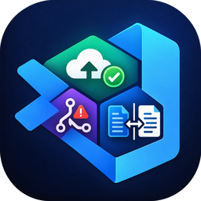
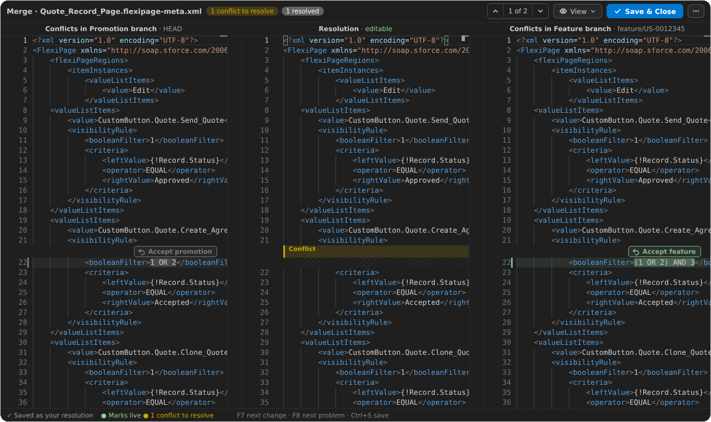
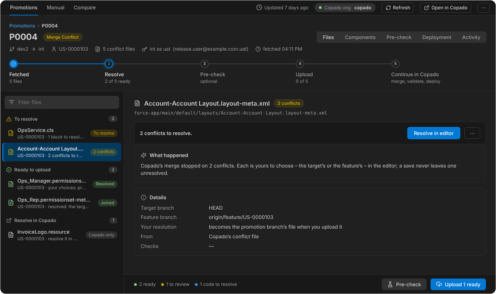

<p align="center">
  
</p>

<h1 align="center">Copado Release Assistant</h1>

<p align="center">
  Resolve Copado promotion conflicts, pre-check them and upload — without leaving VS Code.
</p>

<p align="center">
  <a href="https://github.com/nikeshvarma/Copado-Release-Assistant/releases/latest"></a>
  <a href="https://github.com/nikeshvarma/Copado-Release-Assistant/actions/workflows/test.yml"></a>
  <a href="LICENSE"></a>
  <a href="https://code.visualstudio.com/"></a>
  <a href="https://developer.salesforce.com/tools/salesforcecli"></a>
</p>

<p align="center">
  <a href="#features">Features</a> ·
  <a href="#getting-started">Getting started</a> ·
  <a href="docs/RESOLUTION.md">How resolution works</a> ·
  <a href="#safety">Safety</a> ·
  <a href="#configuration">Configuration</a> ·
  <a href="#development">Development</a>
</p>



## Features

What it reads, what it writes, and the rules for each kind of file, in one page: [How resolution works](docs/RESOLUTION.md) — and every rule, numbered, in the [Rule book](docs/RULES.md).

### Promotion conflicts, resolved without losing anything

Open a promotion that stopped on a merge conflict — by its number or its Copado link, in the **Promotions** tab's one box — and every conflicted file is fetched at once: **Copado's own conflict files**, nothing read from a branch. The files are grouped *To resolve*, *Ready to upload*, *Uploaded* and *Resolve in Copado* — each with a status pill — and each file's panel has one primary action, **Resolve in editor**, with what it will do beside it. Files that are neither code nor metadata (static resources, images, JSON, text) are resolved in Copado: never opened here, never uploaded from here. Metadata and code open in the same merge editor with git's merge kept as it is, each of its conflicts yours to choose. Upload all resolutions in one step, read back from Copado, with undo.



### See what the stories committed

The **Components** tab lists every component the promotion's stories committed, grouped by type: its action, its story and where it stands — a conflict to resolve or resolved, on the branch, or not on the branch after a pre-check. Filter by what needs doing or by name; a conflict opens its file.


### A merge editor built for Salesforce metadata and code

Everything comes from **Copado's conflict file**, as Copado's own merge made it: git had the common ancestor, so whatever only one story changed is already merged — the feature's deletions applied, other stories' work kept — and stays as it is. Only git's **conflicts** are marked, metadata and code alike: both versions shown — the target's greyed out, the feature's in its colour — and neither in your resolution until you choose **Accept target** or **Accept feature** (code also offers **Accept both**; two versions of one metadata element are rarely valid, so metadata offers it only where the two stories each add their own entry at the same place — two picklist values, two flow formulas — and it keeps the two). **Each row says what you are choosing**: the element the conflict is in and what each version sets — *Section Case Information › field Dispute_Amount__c: Behavior Required → Readonly* — with each side's value beside its own version; in code, the member — *Conflict · method total(Decimal)*. A flow's conflict that only moves the canvas — `locationX`/`locationY` — is the feature's, marked, with **Use target**. A resolved conflict says so, in green, still a click from changing; **⋯ › Accept all target** or **Accept all feature** resolves every one at once. It opens in **Copado's own three panels** — *Conflicts in Promotion branch*, *Resolution*, *Conflicts in Feature branch*, each branch named as Copado's file names it — level with each other, the words that differ lit within a line; **→** and **←** take a side's lines into the resolution, **Accept both** sits between. **View › Layout** switches to one panel or two, and remembers it (`cmr.merge.codeView`); each version is shown once — in two panels, the target's lines stay on the left, with **Accept target** beside them, and only the feature's version sits under the conflict. Every choice is undone with `Ctrl+Z`.

**Permission sets, profiles, muting permission sets, labels and translations (global and standard value set translations too)** — files whose entries add up — are joined, whatever git's blocks: the two sides are rebuilt from Copado's file and joined entry by entry. The target's entries are kept as they are, the feature's are added beside their kind, or applied where it changed one; an entry both have stays once. Entries are matched by what identifies them: a field permission by its field, a user permission by its name. A label or translation whose value the target and the feature hold differently is yours to choose. **Nothing of the target is removed — and nothing that grants less is taken for you**: where the feature would turn access off (`editable`, `readable`, `enabled`, `visible`, an `allow…`, a tab's visibility — in a muting permission set, turning one on), that entry is a conflict for you to choose, target or feature. Should a file's sides not join, its blocks are conflicts and **Accept feature** is not offered, so the target's access is never one click from gone. A profile's security settings — IP ranges, login hours, password and session settings — are always yours to choose. An entry the target itself has twice, the same, loses its second copy, shown as *Duplicate* with **Keep**; twice and different, the copy granting more is kept — *Duplicate · the copy granting more kept*, with **Keep … instead** to use the other.

**A save never leaves a gap**: with conflicts unresolved, **Save** offers to keep the target's version for them, or to go back — and a file with a conflict unresolved is never uploaded. Each conflict's lines are tracked by the editor as you type, so editing around one never loses it.

Broken XML is underlined exactly where it breaks. For permission sets, profiles, labels and translations a duplicate entry is marked on its own lines with the line it repeats, and **Format and Order Metadata** and **Remove Duplicate Entries** are in the right-click menu.


It is an editor you can work in all day: the parent elements stay pinned as you scroll, elements fold (the target with them), matching tags light up and an opening tag closes itself, **Format and Order Metadata** in the right-click menu puts a permission set or profile in Salesforce's order, and **View** has zoom, word wrap that keeps the panes level, and a divider to drag.

### Code, too

A promotion's **Apex**, **Lightning web component** JavaScript, HTML and CSS, **Visualforce** and **Aura** conflicts open in the same editor, from **Copado's conflict file** as git merged it. Git had the common ancestor, so everything only one story changed is already merged — the feature's deletions applied, other stories' work kept — and shown as plain text. Only the **conflicts** are marked: both versions shown — the target's greyed out, the feature's in its colour — neither in your resolution until you choose **Accept target**, **Accept feature** or **Accept both**. Once you choose, its row says *Resolved*, in green, the version you chose marked — still a click from changing. A version with nothing in it is a choice too: a feature version that removes lines says so, and once accepted the row says **Removed**, the lines struck through in red — or, where only the feature added, **Left out**, struck through in grey. Green only ever means lines that are in your file. **⋯ › Accept all target** or **Accept all feature** resolves every conflict at once — one step, Ctrl+Z undoes it. The conflict markers are never shown. Saving with one not resolved warns first. It opens in the same three panels as metadata — **View › Layout** switches to one or two (`cmr.merge.codeView`). Brackets that do not balance and a member defined twice are underlined once its conflicts are resolved. VS Code's own conflict view is a setting away.


### Validate before Copado does

Check a promotion's resolutions, or a user story straight from its feature branch, against the target org — check-only, nothing deploys. Errors point to the right line, with suggested fixes.

When a pre-check stops at something the target does not have — a field, a class — what is missing is read from the errors and listed, each with what needs it. **Add to pre-check** borrows it from the source org, read-only, and runs the pre-check again, so the errors it was hiding show; **Add components…** picks any others by type and name. Borrowed components are for the pre-check alone — never deployed, never added to the story or the promotion — and the pre-check says the promotion still needs them.

Errors are grouped by cause: something missing in the target, a component a story has in an older version, or an error in the code itself. Every story in the promotion is read. **To commit to a story** lists everything the pre-check borrowed or found missing. **Open as package.xml** or **Copy the list** gives you the whole list, so the items can be committed to a story at once.


### Upload knowing what goes up

Before anything is uploaded, the dialog runs a checklist: files still to resolve, files changed since the pre-check, a pre-check that failed or never ran, access a resolution takes away, duplicates, and borrowed components no story has. Each item says what to do, followed by a list of the files that will go up. Each file is saved as uploaded as soon as it is up, and **Undo** tries every file, so an interrupted upload never loses track. In metadata, a conflict row says what the choice means, such as *Edit access true → false – the feature removes access*. **⋯ › Save review to share…** writes the whole review as a Markdown report.

### Compare two versions, with or without Copado

The **Manual** tab — always there — compares two versions pasted from Copado's conflict screen, or any two files, side by side: nothing merged, **both sides editable**. For permission sets, profiles, labels and translations — whose entries add up — **Format and Order Metadata** and **Remove Duplicate Entries** in the right-click menu work on either side, so order and formatting drop away and only real differences are left. What only the other side has is shown struck through, in red. Each comparison starts from exactly the two versions shown — **Clear both** empties them at once. It also builds a `package.xml` from a Copado commit file. Right-click an XML file → **Compare in Release Assistant…** to start from it.


### Compare two branches

The **Compare** tab lists every file one branch changed since it split from another — what merging it would bring — what was removed or changed first, then what is new, grouped by metadata type, each with what differs in a few words: *4 elements differ · 1 duplicate*, *3 members differ* — a file that differs only in spacing is the same, and left out. Each branch is picked by searching for it, however many there are; **All types** narrows the list to the types you choose, **Search** to a name, **Reset** starts again; the files are shown 50 at a time. **Compare** opens a file in the same side-by-side comparison, both branches' versions editable — **F7** goes through the differences. The branches are read from the connected repository; nothing in git is changed.


For permission sets, profiles, labels and translations, the extension's own **Format and Order Metadata** and **Remove Duplicate Entries** are in the merge editor's right-click menu, as in VS Code's editor. Never for a layout, a page or a flow, whose order is what users see.

### And more

- **Branch conflicts** between two git branches, with the merge-base — nothing checked out or changed.
- **Checks as you type** for duplicates and deploy-breaking metadata rules - and in code, brackets that do not balance and members defined twice.
- **Formatting** in the order Salesforce writes metadata, so diffs show only real changes.
- **Team guardrails** in `copado-policy.json`: which orgs, which test levels, per environment.
- **Clean Working Files** empties `.copado/` — after listing what is there and naming any resolution not uploaded yet. Old working files are removed by themselves after `cmr.storage.keepDays`, never a resolution not uploaded.

## Getting started

**Requirements:** VS Code 1.90 or later, the [Salesforce CLI](https://developer.salesforce.com/tools/salesforcecli) v2 with your orgs logged in, and git 2.38 or later for branch conflicts.

1. Download the `.vsix` from the [latest release](https://github.com/nikeshvarma/Copado-Release-Assistant/releases/latest) and install it:
   ```bash
   code --install-extension copado-release-assistant-5.1.2.vsix
   ```
2. Open your Salesforce project folder.
3. Run **Copado: Open Settings** and set **Copado org** — the Salesforce CLI alias of the org where Copado runs.
4. Run **Copado: Open Release Assistant**.

Without a Copado org, the **Manual** tab works on its own.

## Safety

- **Nothing deploys.** Every validation is check-only.
- **Git is read-only.** No checkout, merge, commit or push.
- **Copado is written only when you confirm** — uploading resolutions and setting a promotion's status.
- **No passwords.** Orgs come from the Salesforce CLI; repository tokens stay in VS Code's encrypted storage.
- **Working files stay in `.copado/`** in your project, never committed.

## Configuration

Every behaviour has a setting — **Copado: Open Settings** lists them all. The ones most teams change:

| Setting | What it does |
| --- | --- |
| `cmr.copado.org` | The org where Copado runs |
| `cmr.merge.removeDuplicates` | Remove identical duplicates when a merge is prepared |
| `cmr.merge.codeIn` | Open code conflicts in the merge editor, or VS Code's own conflict view |
| `cmr.merge.codeView` | A promotion's file in one panel, two, or three — Copado's own (the default) |
| `cmr.storage.keepDays` | Working files older than this many days are removed by themselves (14; 0 never) |
| `cmr.borrow.sourceOrg` | The org the pre-check borrows missing components from (a CLI alias); empty: asked for once |
| `cmr.promotion.autoResolve` | Resolve files that need no decision automatically (off by default) |

**Write Recommended Settings to Workspace** shares a team's settings through `.vscode/settings.json`.

## Development

```bash
npm test               # unit tests - no dependencies to install
npm run check          # unused code, activation
npm run package        # builds dist/copado-release-assistant-<version>.vsix
```

Browser tests of the merge editor and tests inside VS Code are described in [CONTRIBUTING.md](CONTRIBUTING.md). CI runs everything on Linux, Windows and macOS; pushing a new version to `main` publishes the release. Report security issues privately — see [SECURITY.md](SECURITY.md).

## License

[MIT](LICENSE) © Nikesh Varma. The merge editor includes [Monaco Editor](https://github.com/microsoft/monaco-editor) (MIT, © Microsoft).

Copado and Salesforce are trademarks of their respective owners. This project is independent and not affiliated with or endorsed by Copado or Salesforce.
