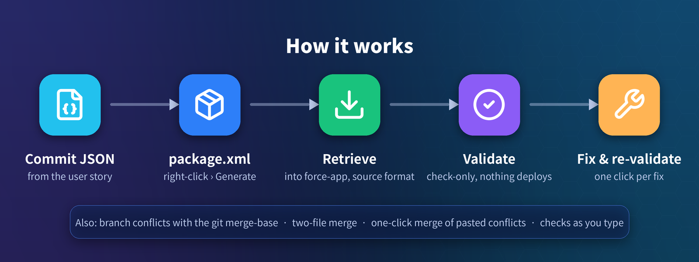
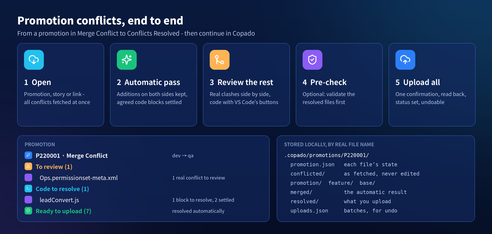
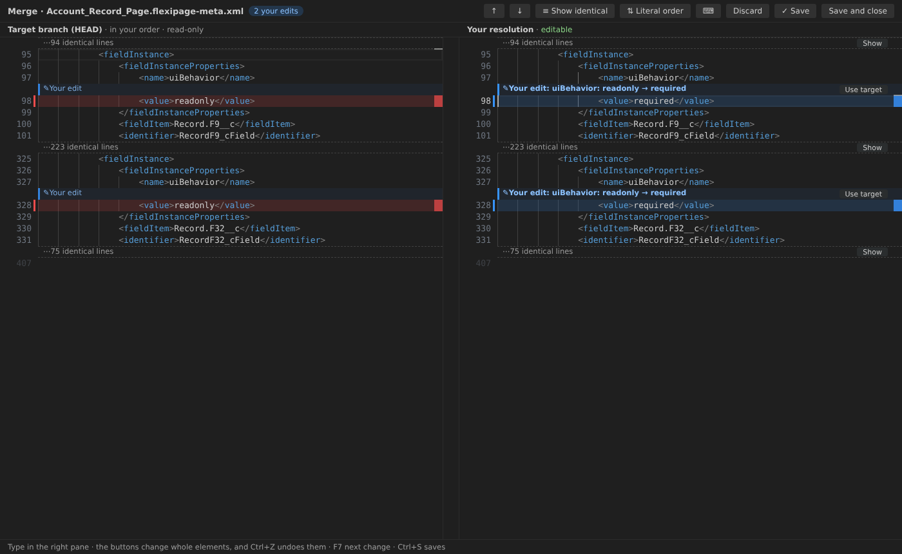
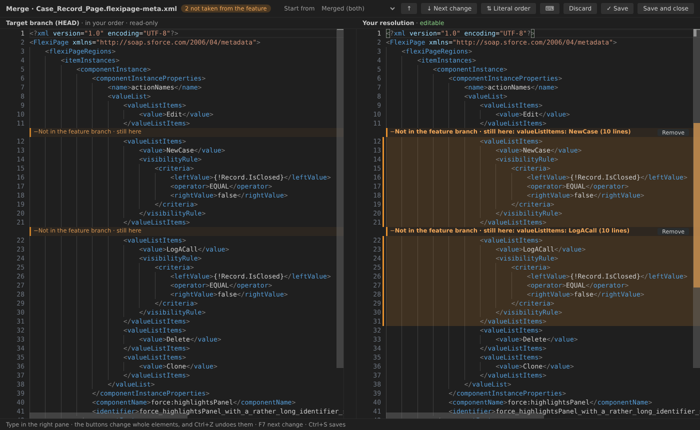
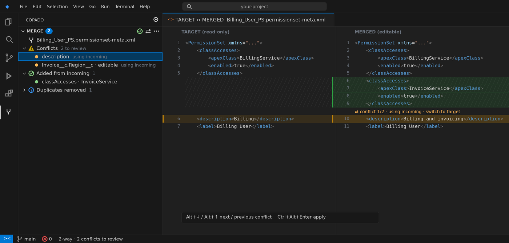
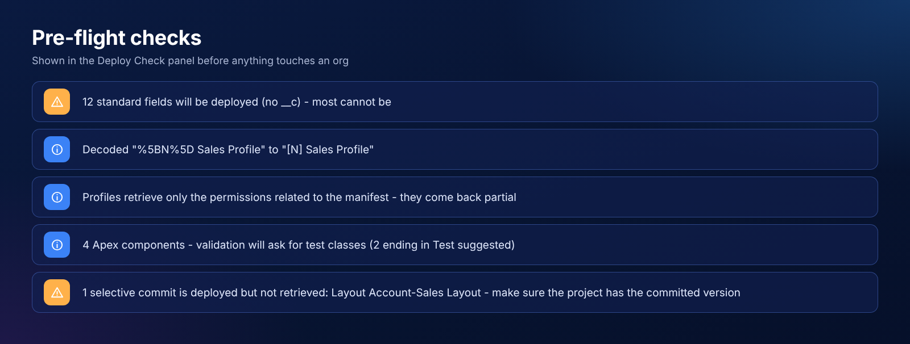
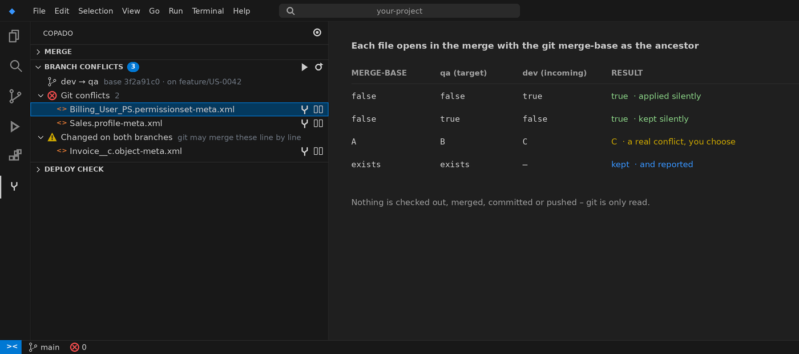

**Copado release work for Salesforce metadata, inside VS Code.** Resolve a promotion's merge conflicts without losing anything, validate a user story against an org before Copado does, find branch conflicts — with every change shown and every decision yours.

`v3.6.0` · by **Nikesh Varma**



Start with **Copado: Open Release Assistant** — the page for promotions and user stories. The Command Palette has twelve starting points; everything else is on the page, in the side bar's *Merge*, *Deploy Check* and *Branch Conflicts* sections (each shown only when it has something), and in right-click menus. Every behaviour has a switch on the settings page — **Copado: Open Settings**. Branch, org and record names on this page are examples.

## Install

```bash
code --install-extension copado-release-assistant-3.6.0.vsix --force
```

Open your Salesforce project folder. The extension finds the project by its `sfdx-project.json` — the project of the file you have open, the open folder, or the single project inside it; with several, set `cmr.project.path`. Paths with spaces are fine. Validation needs the **Salesforce CLI** (`sf`) with your orgs already logged in — the extension never sees or stores a password. Branch conflicts need **git 2.38+**.

## Everything stays in your project

- **`manifest/`** holds `package.xml`, replaced each time you generate one, and `destructiveChanges.xml` when a commit deletes something.
- **`.copado/`** holds the working files — merges, promotions, check workspaces, reports. It contains a `.gitignore` of `*`, so it is never committed and your own `.gitignore` is left alone.
- **`force-app/`** is changed only when you ask: applying a merge, applying a fix, Format Document.

Both folder names are settings.

## 1 · Promotion conflicts



When a Copado promotion stops on a merge conflict, Copado attaches each conflicted file to the promotion with git conflict markers. The **Release Assistant** page takes it from there:

1. **Open** — a promotion number (`P12345`), a user story, the promotion's Copado link, or one of the recent ones. Every conflict file is fetched at once.
2. **Suggested merges** — each metadata file is split into its two sides (and the common ancestor, when the markers carry it) and merged for you to review. **Nothing is resolved without you** (`cmr.promotion.autoResolve`, off by default); code keeps every conflict block for you to decide.
3. **Review** — **Review in merge** opens the file in the [merge editor](#2--the-merge-editor). **Accept the suggestion** is offered only when nothing would be lost — a merge that keeps what the feature branch does not have, or has a real conflict, is reviewed in the merge editor. **Code to resolve** opens the file with its markers for VS Code's *Accept Current / Incoming / Both*. **Compare sides** shows the two branches; **Reset** goes back to the suggestion.
4. **Pre-check** (optional) — the **Pre-check** tab validates your resolutions, check-only, against the promotion's destination: the stories' feature branches with your resolved files on top, in a separate workspace — your project is never touched. A file not resolved yet is left out, and said so. Each problem links to your resolution.
5. **Upload all** — one confirmation lists every ready file and any held back. Each must have no markers left; metadata must be well-formed XML of the right type, without duplicates or deploy-breaking errors. Each conflict attachment is renamed `RESOLVED <story> <path>` with your content — what Copado's own resolution editor does — and read back. After the last file it sets the promotion's status to your org's *Conflicts Resolved*, if you choose. **Undo** puts the whole batch back.

Then continue the promotion in Copado — the page links there. Its **Deployment** tab follows Copado's validation or deployment read-only, with each component error linked to your resolution. A resolution already in Copado can be changed with **Edit again**: uploading replaces it there, only if Copado still holds the version you started from. Replacing a resolution offers to tick Copado's **Re-create promotion branch** checkbox; it is unticked by itself once Copado's next validation or deployment succeeds.

Everything is kept in `.copado/promotions/<promotion>/` by real file name, so closing VS Code loses nothing. **Refresh** looks at Copado again: files resolved in Copado meanwhile are marked and never overwritten. Finished promotions are removed after `cmr.promotion.keepDays` (30).

## 2 · The merge editor


**Review in merge** — and *Merge two files*, quick merge and branch conflicts — open the extension's own merge editor: the target on the left, read-only; your resolution on the right, in a real editor (Monaco, the editor VS Code is built on, shipped inside the extension). The two are lined up **element by element**, not line by line — metadata XML repeats the same lines everywhere, so a line comparison pairs a deleted block's lines with the next block's. Elements are matched by what they are: the metadata type's key (a field permission by its field), an identifier, a name, a value — and lists whose order is their meaning (layout columns, flow conditions) in order.

| Mark | Means | Button |
| --- | --- | --- |
| green | from the feature branch | **Undo** |
| blue ✎ | your own edit | **Undo** · **Use target** |
| red, struck through | the target has it; your resolution does not | **Restore** |
| purple ↕ | moved — *1st → 3rd*, and whether anything inside changed | **Move back** |
| orange − | not in the feature branch, still in your resolution | **Remove** |
| orange ≠ | the feature branch has another value | **Use feature** |
| yellow ! | both branches changed it | **Use target** · **Use feature** |

Every button changes whole elements, in one step that **Ctrl+Z** undoes, and only if the lines are still what was marked. The left side is the target **in your order**, so a block you moved sits level with itself; **Literal order** shows the target as it is. While the XML is not valid as you type, the marks pause and say so.

**Hide identical** folds away the lines that are the same on both sides, keeping three around every change, move and conflict — a row *⋯ 223 identical lines* with **Show** stands in for each run, in both panes alike. Going to a line inside one (Ctrl+G, a find match, a click) opens it. The choice is kept for the next merge (`cmr.merge.hideIdentical`).



### Nothing merged behind your back



Your resolution starts where **`cmr.merge.startFrom`** says. By default, the **merged** result for permission sets, profiles, labels, translations and objects — files often retrieved in part, where an entry the feature branch lacks is not a removal — and the **feature branch's** file for everything else (pages, layouts, flows…), so its removals count. **Start from** in the toolbar switches between the feature branch, the target and the merged result. Whatever the start, what the other branch has is marked — including what the feature branch does not have. Without the common ancestor nobody can tell whether the feature branch removed something or the target added it later, so the marks say *not in the feature branch* and leave the decision to you.

### Keys

VS Code's own, with **Cmd** for Ctrl on a Mac — **⌨** in the toolbar lists them.

| | |
| --- | --- |
| Cut, copy, paste | Ctrl+X · Ctrl+C · Ctrl+V — through VS Code's clipboard, also in the right-click menu |
| Undo, redo | Ctrl+Z · Ctrl+Y / Ctrl+Shift+Z |
| Find, replace, go to line | Ctrl+F · Ctrl+H · Ctrl+G |
| Move, copy, delete a line | Alt+↑/↓ · Shift+Alt+↑/↓ · Ctrl+Shift+K |
| Comment out, indent | Ctrl+/ · Tab / Shift+Tab |
| Next match, another cursor | Ctrl+D · Alt+click |
| Next, previous change | F7 · Shift+F7 |
| Save | Ctrl+S |

Both panes scroll together, up and down and side to side. **Save** (Ctrl+S) saves your resolution and keeps the editor open; **Save and close** applies it, with the checks below. A plain *Merge two files* has **Apply and close**. To use VS Code's own diff view instead, set `cmr.merge.editor` to `vscode`:



Applying warns about values both branches changed and you have not settled, broken XML, leftover duplicates and failed deploy rules.

## 3 · Validate a user story

**Copado: Prepare User Story from Copado** takes a story number (`US-0012345`): it fetches the story's commit file and builds `manifest/package.xml` from it, and matches the story's environment and the next one in its pipeline to your Salesforce CLI logins — by the org credential's username, or by a choice you make once (`cmr.copado.environmentOrgs`). **Validate User Story from Its Feature Branch** validates the story's components as Copado committed them — permission sets and profiles included, without other people's changes — in a separate check workspace; your project is never touched. The repository is read from Copado's pipeline, or set with **Connect Repository**: Azure DevOps, GitHub, GitLab or Bitbucket, read-only, with the token in VS Code's encrypted secret storage.

**Copado: Inspect User Story in Copado** writes a read-only report of a story — its commits and attached files, metadata records, promotions, pipeline and environments — to `.copado/inspect/`. Files are opened only to say what they are; anything named like a key or credential is never opened. Turn on *Mask identities* before sharing it.

### package.xml from a Copado commit

Right-click one or more commit JSON files → **Generate package.xml from Copado Commit JSON**. Several stories combine into one package, written to `manifest/package.xml`.


Before anything touches an org, pre-flight checks in the *Deploy Check* section:



### Validate against an org


**Validate Deployment Against an Org** checks the project's files as they are — check-only, nothing deploys. The output panel shows each command exactly as you would type it and the Salesforce CLI's own progress — whole snapshots when its words change, not spinner noise. Results go to the *Deploy Check* section, each at the right line, with a fix where one is known:

| The error | The fix offered |
| --- | --- |
| `In field: X - no Type named Y found` | add Y to the deployment — or, if it is RetrieveOnly, deploy it too · **or** remove the reference |
| `Entity of type 'T' named 'N' cannot be found` | add it to the deployment |
| `The user license doesn't allow the permission: X` | remove the user permission |
| `Unknown user permission: X` | remove it |
| `Permission X depends on permission(s): Y` | enable Y · or remove X |
| a standard field fails, in any wording | remove it from the deployment |
| `no CustomObject named X` where X is a standard object | advice: the target org lacks a feature or license |
| `Custom metadata type X__mdt is not available` | add the custom metadata type to the deployment |
| test failures, coverage | shown with class, method and message — no metadata fix exists |
| anything else | the raw message at the right line, **no guess** |

A fix to a file leaves it unsaved for review; a fix to the package rewrites `manifest/package.xml` — make the same change on the story in Copado. **Re-validate** checks the project as it is now. Results read *Validated successfully* or *Validation failed*, with the errors. **Copy Validation Report** gives a markdown table for the story.

## 4 · Branch conflicts

**Copado: Check Branch Conflicts** — pick the target branch (the one that keeps everything, for example `qa`) and the incoming branch (`dev`, or a feature branch). Computed with `git merge-tree`: **nothing is checked out, merged, committed or pushed**. Click a file and it opens in the merge editor with the **merge-base filled in from git**, so a value only one branch changed is applied without asking:




## 5 · Merging two files

For the two files of a manual conflict: right-click the version to keep everything from → **Use as Target**, then the other → **Merge This File Into Target** — or **Copado: Resolve Metadata Conflict (two files)**. **Swap Direction** merges the other way round; **Copy Merge Report** gives a markdown summary.

**Quick merge** — keep Copado's two versions in `conflict/metadata/resolution.xml` (kept whole) and `feature.xml` (merged in): a **Merge feature → resolution** button appears in the status bar whenever both exist. Turn on *auto-merge after paste* from its tooltip and the merge opens by itself once both are saved.

## Checks as you type

Duplicates judged on Salesforce identity (`fieldPermissions` on `<field>`, `layoutAssignments` on `<layout>` + `<recordType>`), and twelve deploy-breaking rules the duplicate check can't see — editable-without-readable, two default record types on one object, the same field twice on a layout. Each rule id can be switched off in `cmr.rules.disabled`.


## Section order

The order Salesforce itself writes, so a retrieved file comes out of a merge or **Format Document** unchanged and Source Control shows only real changes:


Entries whose order matters (layout sections, picklist values) keep their order. Your own order per type: `cmr.format.typeOrder`. To merge without reordering anything, turn off `cmr.merge.applyFormatting`.

## Settings


**Write Recommended Settings to Workspace** puts shared defaults into `.vscode/settings.json` so the team formats metadata the same way.

## Guardrails

A **team policy** decides which orgs may be validated against, with what tests. **Copado: Create Team Policy File** writes `copado-policy.json` at the project root; commit it, and it applies to everyone who opens the project:

```json
{
  "allowedTargetOrgs": ["qa", "uat*"],
  "blockedTargetOrgs": ["uat-old"],
  "allowProduction": true,
  "minimumTestLevel": { "production": "RunLocalTests" },
  "environments": { "UAT": { "minimumTestLevel": "RunLocalTests", "coverage": 75 } }
}
```

Orgs match by alias or username, `*` as a wildcard; an org the CLI cannot describe counts as production. A blocked target stops the validation with the reason, before any question about tests; a test level below the minimum is raised, and the output says so. `environments` sets per Copado environment a minimum test level, the login it must be validated as (`requiredTargetUser`, `*` as a wildcard), and a coverage minimum checked per class. A broken policy file blocks validation instead of silently allowing everything. Without a policy file, the same rules come from the *Guardrails* settings.

## Network, trust and safe logs

Behind a corporate proxy: `cmr.http.proxy`, VS Code's *Http: Proxy*, or `HTTPS_PROXY` (with `NO_PROXY`), and `cmr.http.caFile` for an extra certificate authority.

In a folder VS Code does not trust, the extension runs neither the Salesforce CLI nor git; merging, formatting and checks keep working, and the folder's own values for settings that point at programs or orgs are ignored until you trust it.

Session tokens are always masked in the output. **Mask identities** (`cmr.output.maskIdentities`) also masks usernames, email addresses, org and user ids and My Domain addresses — in the output and in copied reports.

## Safety

- **Nothing deploys.** Validation is check-only — `deploy validate`, or `deploy start --dry-run` when no tests run — and a test enforces it.
- **Git is read-only.** No checkout, merge, commit, reset or push.
- **Copado is written only when you confirm**: uploading resolutions (one update per conflict attachment, read back, undoable), the promotion's status after the last one, and the *Re-create promotion branch* checkbox. Opening promotions, inspecting and preparing stories only read.
- **Nothing is resolved without you**, and a merge that would keep what the feature branch removed is never accepted in one click.
- **No credentials.** Orgs come from the Salesforce CLI; repository tokens are kept in VS Code's secret storage.

## Development

```bash
npm test                  # the unit tests - no dependencies to install
npm run check             # no unused code; the extension activates with every command
npm run package           # builds dist/copado-release-assistant-<version>.vsix - plain Node, nothing to download
npm run package:check     # the .vsix: what it must hold, and that it activates from itself

# the merge editor in a real browser, with the real Monaco
npm install --no-save playwright && npx playwright install chromium
npm run test:browser

# the extension inside a real VS Code
npm install --no-save @vscode/test-electron
npm run test:vscode       # on Linux without a display: xvfb-run -a npm run test:vscode
```

GitHub Actions (`.github/workflows/test.yml`) runs all of it on every push: the unit tests on Linux, Windows and macOS with Node 18, 20 and 22, the checks and the package (kept as a downloadable artifact), the browser tests, and the VS Code tests on all three systems.

**Releases are automatic.** Bump `version` in `package.json`, add its `## <version>` section to `CHANGELOG.md`, and push to `main`: when that version has no tag yet, `.github/workflows/release.yml` runs the whole test workflow, and if it passes, builds the `.vsix`, makes the tag `v<version>` and publishes the GitHub release with that section as its notes and the `.vsix` attached. A version like `2.0.0-beta.1` is a pre-release. Pushing the tag yourself (`git tag v1.2.3 && git push origin v1.2.3`) releases the same way, if it matches the version. A push that does not change the version releases nothing. To publish to the Marketplace with `vsce` (`npm run package:vsce`), add a `repository` field to `package.json` first. Press **F5** in VS Code to run the extension in a development host. See [CONTRIBUTING.md](CONTRIBUTING.md).

## License

[MIT](LICENSE) © Nikesh Varma

The merge editor includes **Monaco Editor** 0.57.0 © Microsoft Corporation, MIT License — `media/monaco/LICENSE.txt` and `ThirdPartyNotices.txt`.

Copado and Salesforce are trademarks of their respective owners. This is an independent project and is not affiliated with, endorsed or sponsored by Copado or Salesforce.
