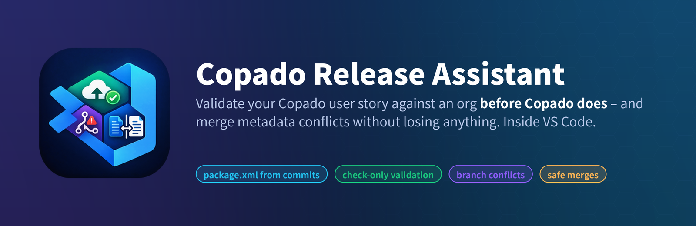

**Copado release work for Salesforce metadata, inside VS Code.** Turn a Copado commit into a `package.xml`, retrieve and validate it against an org before Copado does, find and merge branch conflicts — and resolve manual conflicts without losing anything.

`v2.6.0` · by **Nikesh Varma**


Everything sits in the **Copado** side bar: *Merge*, *Branch Conflicts* and *Deploy Check*. Every behaviour has a switch on the settings page — **Copado: Open Settings**, or the gear in any panel. Branch and org names in this page are examples; nothing is assumed about yours.

## Install

```bash
code --install-extension copado-release-assistant-2.6.0.vsix --force
```

Open your Salesforce project folder. The extension finds the project by its `sfdx-project.json` — the project of the file you have open, the open folder, or the single project inside it — and uses it for everything below. If the open folder holds several projects, set `cmr.project.path`. Paths with spaces are fine. Branch conflicts need **git 2.38+**. Retrieve and validation need the **Salesforce CLI** (`sf`) with your orgs already authorised — the extension never sees or stores a credential.

## Everything stays in your project

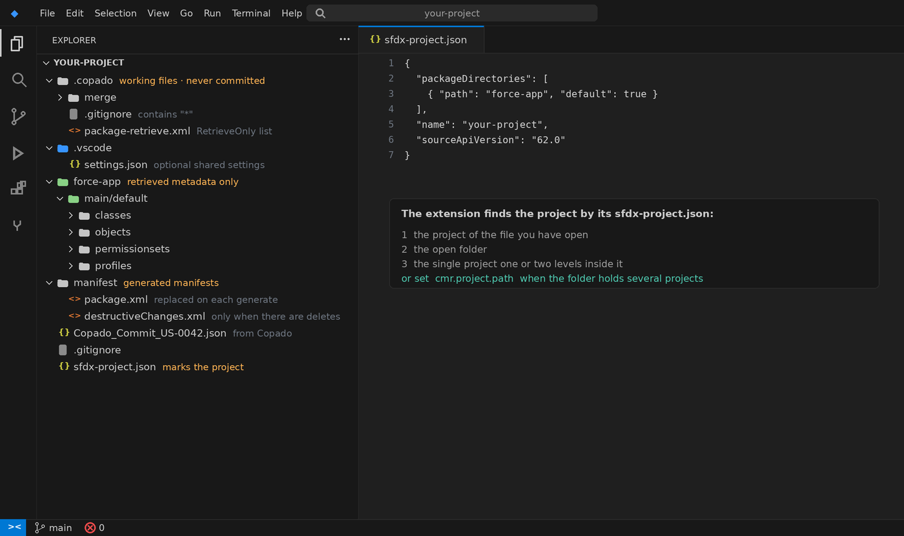

- **`manifest/`** holds `package.xml`, replaced each time you generate, and `destructiveChanges.xml` when the commit deletes something.
- **`force-app/`** receives retrieved metadata, the standard way. Nothing else is written there.
- **`.copado/`** holds the extension's working files — merge views, and `package-retrieve.xml` when the retrieve list differs from `package.xml`. It contains a `.gitignore` of `*`, so it is never committed and your own `.gitignore` is left alone.

Both folder names are settings.

## 1 · package.xml from a Copado commit

Right-click one or more commit JSON files → **Generate package.xml from Copado Commit JSON**. Several user stories combine into one package. The result is written to `manifest/package.xml`, replacing any existing one.

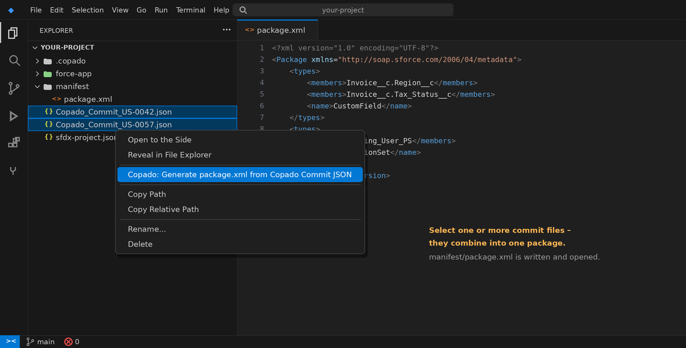

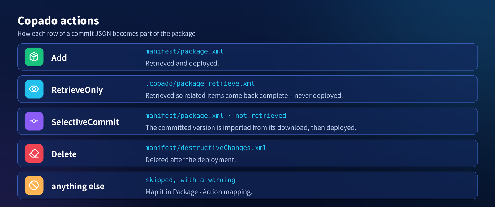

Before anything touches an org, a pre-flight list in the *Deploy Check* panel:


### Selective commits

For a selective commit, Copado commits only the changes you selected and keeps that version as a file, named after the row's `selectiveCommitHash`. Download those files into **`conflict/selective`**: the extension recognises each one by its name, checks that its XML is the right type, and copies it into `force-app` before a validation, so the validation deploys exactly what Copado committed. It asks first, with an option to see the differences; the files it replaces are backed up and **Copado: Undo Last Selective Import** puts them back. Imported downloads move out of the folder, so the next user story starts clean. **Copado: Import Selective Commit Files** imports without validating.

**Straight from Copado.** Set **Copado org** (`cmr.copado.org`) to the alias of the org where Copado runs, logged in with the Salesforce CLI (`sf org login web --alias copado`). **Copado: Download Selective Commit Files from Copado** then fetches each committed version by its file id, and the validation prompt offers *Download from Copado* for anything missing. The CLI handles the login - single sign-on, token refresh and any proxy - so the extension never sees a password. The Package row in *Deploy Check* says what each selective commit needs.

### Prepare a user story straight from Copado

**Copado: Prepare User Story from Copado** takes a story number and does the rest: it fetches the story's commit file from Copado and builds `manifest/package.xml` from it, puts its selective-commit files in the drop folder for the import, and matches the story's environment and the next environment in its pipeline to your Salesforce CLI logins - by the org credential's username, or by a choice you make once, remembered in **Environment orgs** (`cmr.copado.environmentOrgs`). Then it offers to validate, with both orgs preselected. Nothing in Copado is changed.

### Promotion conflicts, end to end


When a Copado promotion stops on a merge conflict, Copado attaches each conflicted file to the promotion with git conflict markers. The **Promotion** panel in the Copado side bar takes it from there:

1. **Open** - **Open Promotion from Copado** takes a promotion number (`P12345`), a user story, or the promotion's Copado link, or offers the recent ones. Every conflict file is downloaded at once, in parallel, through one login.
2. **Automatic pass** - each file is split into its two sides (and the common ancestor when the markers carry it) and merged in the background. Metadata XML where both branches only *added* entries needs no decision and goes straight to **Ready to upload**; code blocks are settled when both sides agree or only one side changed.
3. **Review the rest** - **To review** lists metadata with real clashes (the same entry changed on both sides): **Review** opens the merge with the promotion branch as the target and the feature merged in; **Accept** takes the automatic result as it is. **Code to resolve** opens the file with its remaining markers for VS Code's *Accept Current / Incoming / Both* - save it and it moves to Ready. **Compare Sides** shows the two branches; **Reset** goes back to the automatic result.
4. **Pre-check (optional)** - **Validate Resolved Files Before Uploading** builds a package from the promotion's own change list plus the resolved files, retrieves the components from the promotion's source org, puts the resolved files on top, and validates check-only against its destination org - with your guardrails and the Deploy Check panel's fixes. It is a pre-check: the other components come from the source org, not the feature branch. **Undo Pre-check Files** restores the project.
5. **Upload all** - one confirmation lists every ready file, and any held back. Each must have no markers left; metadata must be valid XML of the right type, without duplicates or deploy-breaking errors. Each conflict attachment is renamed `RESOLVED <story> <path>` with the resolved content - exactly what Copado's resolution editor does - and read back byte for byte. After the last file it sets the promotion's status to your org's *Conflicts Resolved* value, if you choose to. **Undo Last Upload to Copado** puts the whole batch back.

Then continue the promotion in Copado (*Merge Changes*, *Validate Changes* or *Deploy Changes*) - **Open Promotion in Copado** takes you there.

Everything is kept in `.copado/promotions/<promotion>/` by real file name: `conflicted/` as fetched, `promotion/`, `feature/` and `base/` for the sides, `merged/` for the automatic result, `resolved/` for what you upload, with each file's state in `promotion.json` and every upload in `uploads.json`. Close VS Code and the panel picks up where you left off. **Refresh** looks at Copado again: files resolved in Copado meanwhile are marked and never overwritten, and a file that changed in Copado is fetched again with your earlier resolution kept beside it. Finished promotions are removed after **Keep finished promotions (days)** (`cmr.promotion.keepDays`, 30); **Close Promotion** removes one now.

### Inspect a user story in Copado

**Copado: Inspect User Story in Copado** takes a story number (`US-0012345`) and writes a read-only report to `.copado/inspect/`: the story, its commits and the files attached to them, its metadata records, its promotions and their attachments, the pipeline with its branches, and the environments - with whether this machine has a Salesforce CLI login for each. Files are opened only to say what they are (a Copado commit file, a selective-commit file, a file with git conflict markers, metadata XML, or for other JSON its key names); their contents never reach the report, and anything named like a key or credential is never opened at all. It asks Salesforce which Copado fields your org has and queries only those, so it works across Copado versions. Turn on *Mask identities* before sharing a report.

## 2 · Branch conflicts

**Copado: Check Branch Conflicts**. Pick the target branch (the one that keeps everything, for example `qa`) and the incoming branch (for example `dev`, or a feature branch). Set defaults in settings to skip the pickers; with none set, the branch you are on is suggested as incoming.


- Computed with `git merge-tree` — **nothing is checked out, merged, committed or pushed**.
- Click a file and it opens in the merge with the **merge-base filled in automatically from git**, so a value only one branch changed is applied without asking:

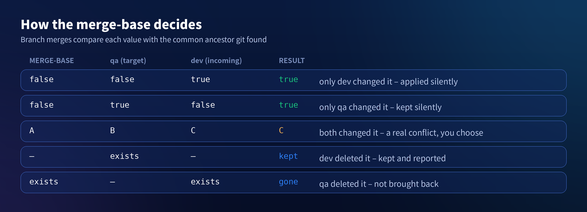

- *Changed on both branches* are files git would merge on its own. A line-by-line merge of metadata XML can still produce duplicates or broken structure, so they are worth the semantic merge too.

## 3 · Deploy check

**Copado: Validate Deployment Against an Org**.

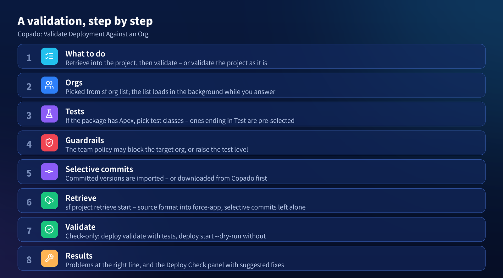

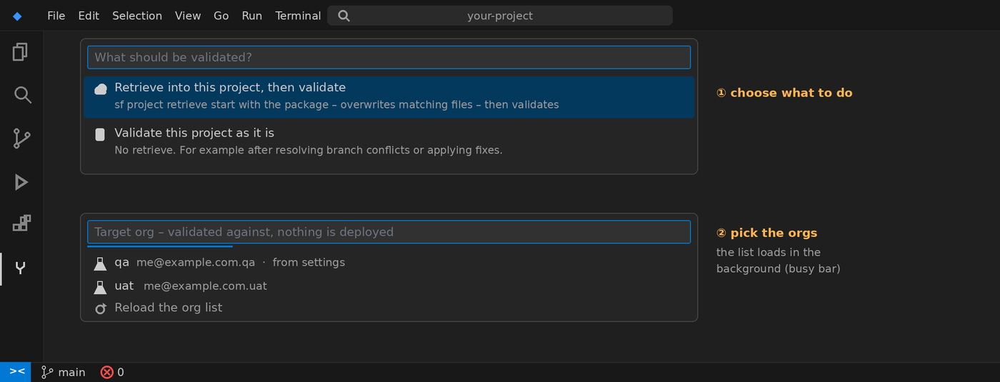

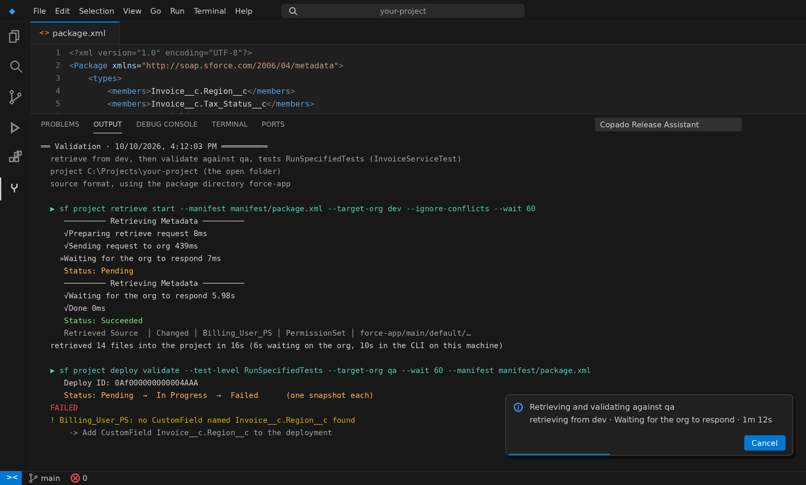

**You see what the CLI sees.** The output panel opens when a run starts and shows each command exactly as you would type it, followed by the Salesforce CLI's own progress as it happens — stages, component counts, test counts, status:

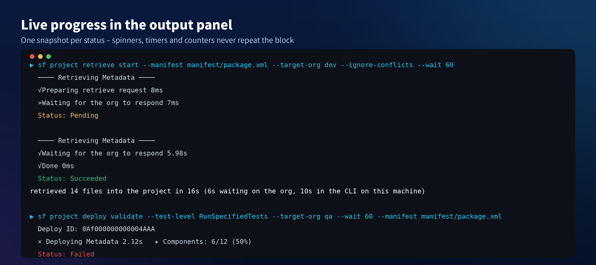

The panel shows **snapshots, not noise**. When its output goes to a pipe, the CLI reprints its whole progress block many times a second. The panel shows that block when it first appears, then again — whole, exactly as it stood — only when its **words** change: the status moving from Pending to In Progress to Succeeded or Failed, a new stage, an error, the result table. Spinner glyphs (`| / - \`) — at the front of a line or standing in for a status that is not known yet — stage symbols, timers and counters are not changes. In the snapshots, the active stage is marked `»` and a status not known yet shows as `…`. Once the status is final, the result table that follows is printed on its own rather than repeating the block. The progress notification shows what the CLI is doing and this command's elapsed time. Output that never reprints is shown line by line as it arrives. To also see an unchanged block every few seconds, set `cmr.validate.progressInterval`.

Each retrieve ends with where the time went — `retrieved 11 files in 2m 3s (1m 54s waiting on the org, 9s in the CLI on this machine)` — so a slow run shows whether the org or your machine was the cause.

**Source tracking is skipped.** After a retrieve, the CLI normally polls the org's SourceMember object to update its local tracking. This extension overwrites files by design, so that step only adds time, and `cmr.validate.skipSourceTracking` (on by default) turns it off with `SF_DISABLE_SOURCE_MEMBER_POLLING`. If you also use tracked commands in the same project, run `sf project reset tracking` afterwards, or turn the setting off.

After a validation, the detailed result is fetched with `sf project deploy report` for the Deploy ID shown.

Retrieved files land in your package directory like any `sf project retrieve`, so **Source Control shows exactly what changed** — the *Retrieved into this project* row opens it. A retrieved profile contains only the permissions related to the manifest, so it replaces your local one with a partial file; review it before committing. Components the source org did not have are listed under *Retrieve warnings*.

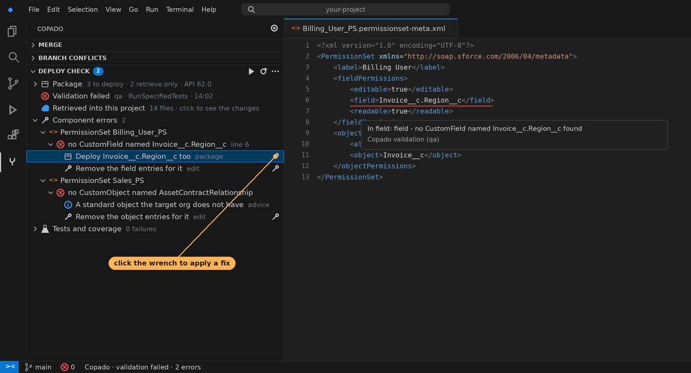

| The error | The fix offered |
| --- | --- |
| `In field: X - no Type named Y found` | add Y to the deployment — or, if it is RetrieveOnly, deploy it too · **or** remove the reference |
| `Entity of type 'T' named 'N' cannot be found` | add it to the deployment |
| `The user license doesn't allow the permission: X` | remove the user permission |
| `Unknown user permission: X` | remove it |
| `Permission X depends on permission(s): Y` | enable Y · or remove X |
| a standard field fails, in any wording | remove it from the deployment |
| `no CustomObject named X` where X is a standard object | advice: the target org lacks a feature or license - enable it, or remove the reference |
| `Custom metadata type X__mdt is not available` | add the custom metadata type to the deployment |
| test failures, coverage | shown with class, method and message — no metadata fix exists |
| anything else | the raw message at the right line, **no guess** |

Edit fixes change the file in your project and leave it unsaved for review. Package fixes rewrite `manifest/package.xml` — make the same change on the user story in Copado. **Re-validate** checks the project as it is and never retrieves, so it cannot overwrite your fixes; it offers to save unsaved files first. If validation cannot start at all — an expired login, a rejected option — the CLI's own message is shown instead of a bare "failed". **Copy Validation Report** gives a markdown table for the story.

## 4 · Merging two files

For the two files Copado hands you in a manual conflict. Right-click the version to keep everything from → **Use as Target**, then the other → **Merge This File Into Target**. Or **Copado: Resolve Metadata Conflict** from the palette.


**The target never loses anything except duplicates.** `Alt+Down`/`Alt+Up` walk the conflicts, `Ctrl+Alt+Enter` applies. Apply warns about unreviewed conflicts, broken XML, leftover duplicates and failed deploy rules. **Swap Direction** merges the other way round, **Use Target Value for All Conflicts** or **Use Incoming Value for All Conflicts** settles every conflict at once, and **Copy Merge Report** gives a markdown summary for the story.

To merge **without reordering anything**, turn off `cmr.merge.applyFormatting` — the target's order is kept and new entries are appended. `Format Document` is unaffected.

### Quick merge for pasted conflict files

Keep Copado's two versions in `conflict/metadata/resolution.xml` (kept whole) and `feature.xml` (merged in). A **Merge feature → resolution** button appears in the status bar whenever both exist, and in the editor title bar while either is open — one click opens the merge, and Apply writes the result into `resolution.xml`. Turn on **auto-merge after paste** from the button's tooltip: the merge then opens by itself once both files have been pasted and saved. Folder, file names and both switches are under *Quick merge* in settings.

### If a merge feels slow

The merge runs in a background thread, so VS Code stays responsive and the progress notification has a **Cancel** button. Every merge writes one line to the output panel showing where the time went — reading the files, the merge itself, writing the views, and opening the diff. If most of it is in *diff*, that is VS Code comparing two very large files; turning on `diffEditor.hideUnchangedRegions.enabled` makes big diffs lighter to show. Starting a new merge always ends the previous one first, so there is no need to reload the window.

## Checks as you type

Duplicates judged on Salesforce identity (`fieldPermissions` on `<field>`, `layoutAssignments` on `<layout>` + `<recordType>`), and twelve deploy-breaking rules the duplicate check can't see — editable-without-readable, two default record types on one object, the same field twice on a layout, and so on. Each rule id can be switched off in `cmr.rules.disabled`.

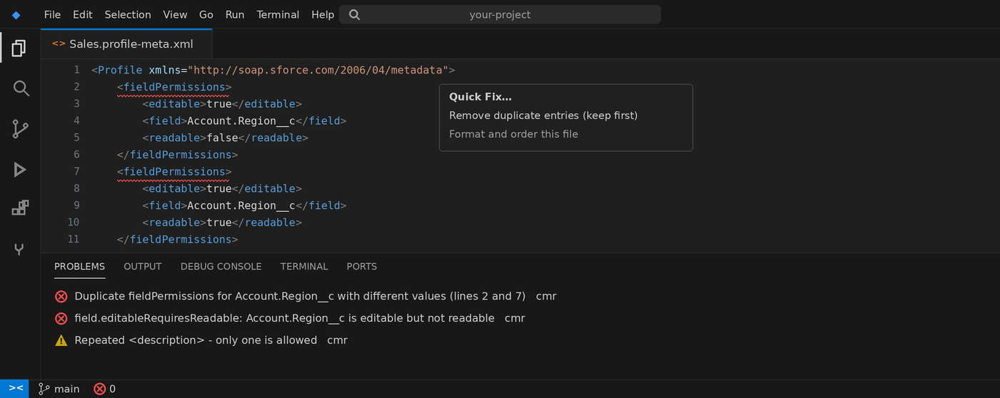

## Section order

The order Salesforce itself writes, so a retrieved file comes out of a merge or **Format Document** unchanged and Source Control shows only real changes:

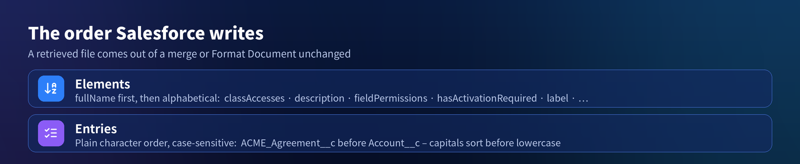

Level 2 and below is never reordered, and entries whose order matters (layout sections, picklist values) keep their order.

Your own order per type: `cmr.format.typeOrder` — listed tags first in that order, the rest alphabetical.

## Settings

Grouped on the settings page:

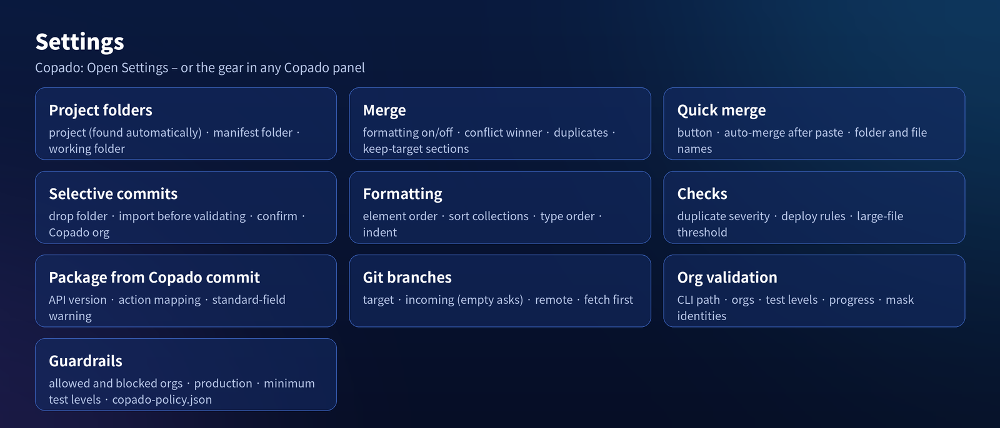

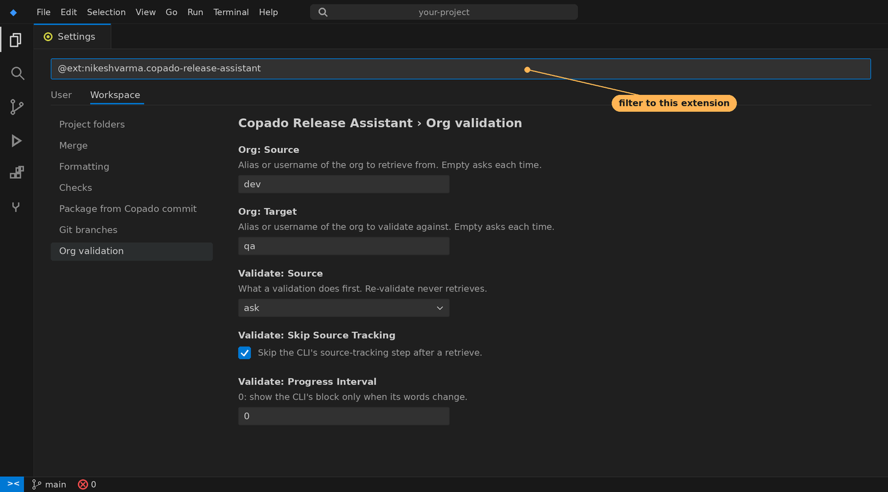

**Write Recommended Settings to Workspace** puts shared defaults into `.vscode/settings.json` so the team formats metadata the same way.

## Guardrails

A **team policy** decides which orgs may be validated against, and with what tests. Run **Copado: Create Team Policy File** to write `copado-policy.json` at the project root, adjust it, and commit it - it applies to everyone who opens the project, is reviewed like any other change, and replaces the personal guardrail settings:

```json
{
  "allowedTargetOrgs": ["qa", "uat*"],
  "blockedTargetOrgs": ["uat-old"],
  "allowProduction": true,
  "minimumTestLevel": { "production": "RunLocalTests" }
}
```

Orgs match by alias or username, with `*` as a wildcard; `production` and `sandbox` match by org kind, and an org the CLI cannot describe counts as production. A blocked target stops the validation with the reason; a test level below the minimum is raised, and the output says so. A broken policy file blocks validation instead of silently allowing everything. Without a policy file, the same rules come from the *Guardrails* settings.

## Workspace Trust and safe logs

In a folder VS Code does not trust, the extension runs neither the Salesforce CLI nor git: retrieve, validation, branch conflicts and Copado downloads are off, while merging, formatting and checks keep working. A folder's own values for the settings that point at programs or orgs - the CLI path, the Copado org, the project path - are ignored until you trust it, so a repository you have just cloned cannot point the extension at a program of its choosing.

Session tokens are always masked in the output panel. Turn on **Mask identities** (`cmr.output.maskIdentities`) to also mask usernames, email addresses, org and user ids and My Domain addresses - in the output and in copied reports - before pasting a log into a ticket. Deploy ids stay, so a run can still be traced.

## Safety

- **Nothing deploys.** The only org operations are retrieve and a check-only deployment — `deploy validate`, or `deploy start --dry-run` when no tests run. The one place that builds `deploy start` always adds `--dry-run`, and a test enforces it.
- **Git is read-only.** No checkout, merge, commit, reset or push.
- **Copado is only written when you upload promotion resolutions and confirm** - one update per conflict attachment, and the status after the last one, each read back and undoable. Opening promotions, inspecting and preparing stories only read.
- **The project is only changed by a retrieve, an import or a pre-check you start** - and the imports and pre-checks back up what they replace.
- **Everything stays in the project.** Manifests in `manifest/`, retrieved metadata in your package directory, working files in `.copado/` — nothing else is written to `force-app`.
- **No credentials.** Orgs come from the Salesforce CLI.

## Development

```bash
npm test                    # no dependencies to install
npm install --no-save @vscode/test-electron && npm run test:vscode   # inside a real VS Code
npx @vscode/vsce package    # builds the .vsix
```

Press **F5** in VS Code to run the extension in a development host. See [CONTRIBUTING.md](CONTRIBUTING.md) for the ground rules.

## License

[MIT](LICENSE) © Nikesh Varma

Copado and Salesforce are trademarks of their respective owners. This is an independent project and is not affiliated with, endorsed or sponsored by Copado or Salesforce.

