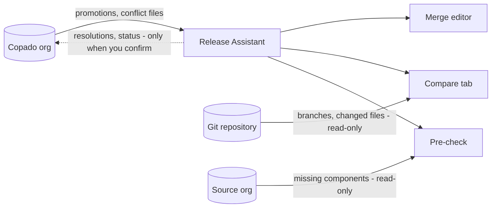
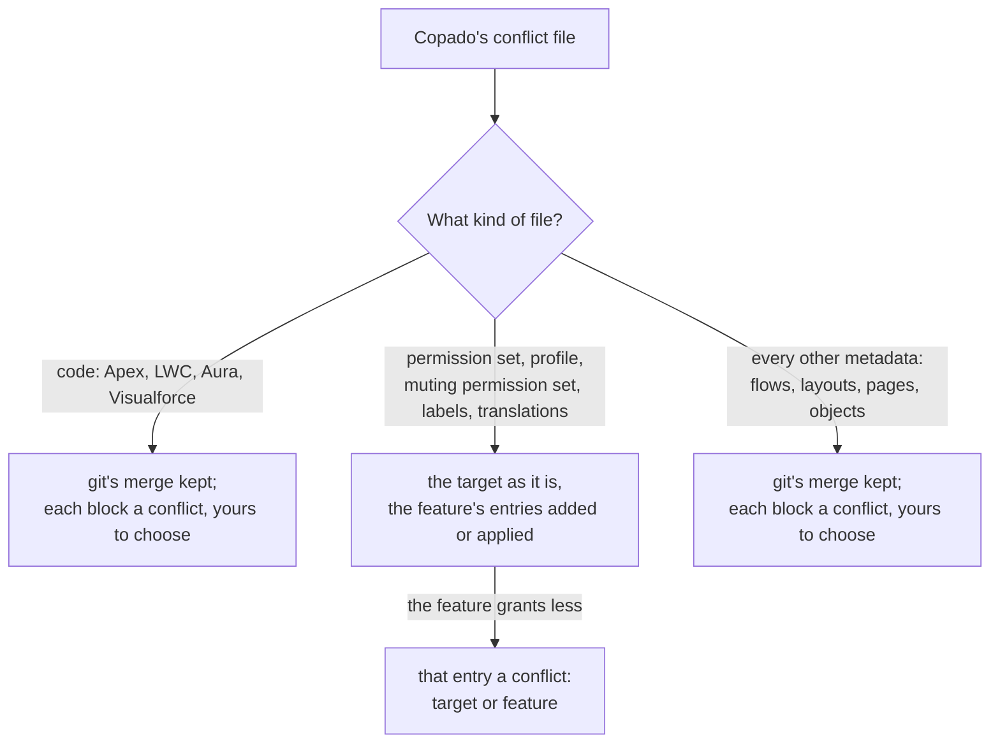
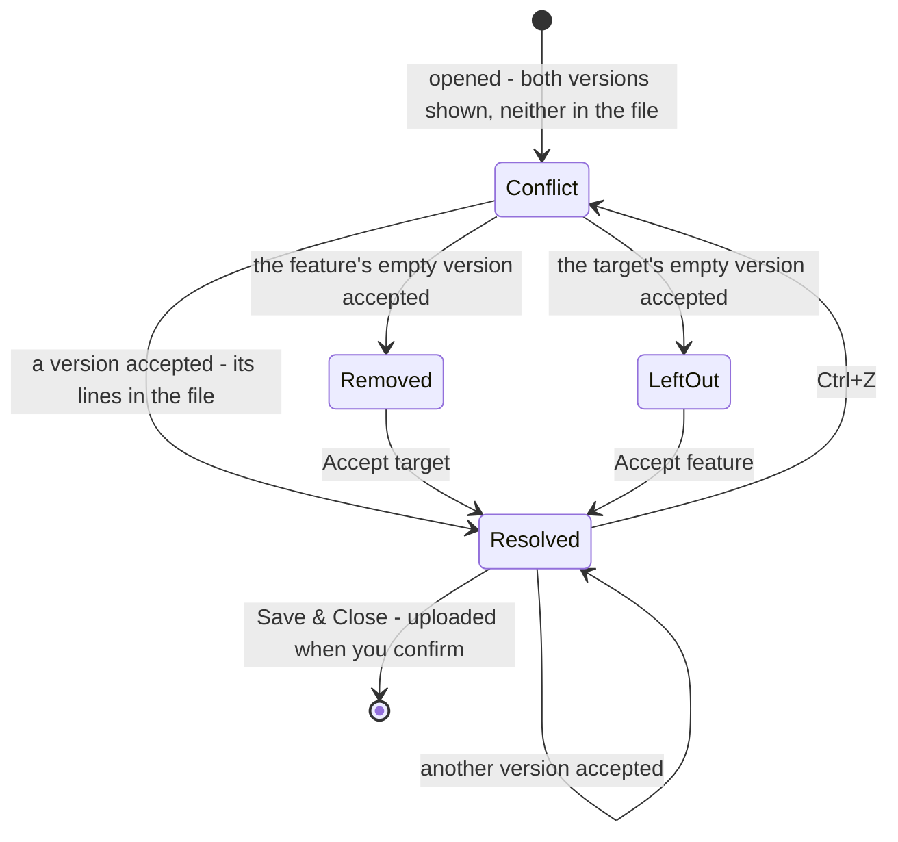

# How resolution works

What the Release Assistant reads, what it writes, and the rules it follows for each kind of file - in one place.

## Where everything comes from

- **A promotion's conflicts come from Copado alone.** The extension downloads the conflict file Copado saved for each file - git's merge, made with the real common ancestor, with a block wherever both branches changed the same lines. No branch is read for a promotion, and nothing is merged again.
- **Copado is written only when you confirm**: uploading resolutions, and a promotion's status.
- **The repository is read by the Compare tab only** - never written.
- **The source org is read by the pre-check only**, to borrow what the target lacks - for the pre-check alone, never deployed.
- Everything fetched is kept in `.copado/` in your project, never committed, and removed by itself after `cmr.storage.keepDays` days - never a resolution not uploaded yet.

## The rules, by kind of file

- **Code**: what only one story changed is already merged by git, and stays as it is. Each conflict block is shown both ways, and **neither version is in your resolution until you choose**: *Accept target*, *Accept feature* or *Accept both*.
- **Every other metadata** — flows, pages, layouts, objects: the same, but **target or feature** — two versions of one element are rarely valid. The exception: where the two stories each **add their own entry** at the same place — two picklist values, two flow formulas — the row says so and **Accept both** keeps the two, whole (B3.6). A flow's block that only moves the canvas (`locationX`/`locationY`) is the feature's, marked, with *Use target*.
- **Every row shows its label only** — *Conflict*, *Resolved*, *Removed*, *Left out* — with the versions under or beside it to compare. The Release Assistant page lists what each metadata conflict is about. A block git started inside an element — a field added before another — is shown as the whole new elements, the existing one untouched (C11).
- **Permission sets, profiles, muting permission sets, labels and translations** - files whose entries add up, and which Copado commits only in part: the two sides are rebuilt from Copado's file and joined entry by entry, whatever git's blocks - the target's entries kept as they are, the feature's added beside their kind or applied where it changed one, an entry both have once. **Nothing of the target is removed, and nothing that grants less is taken for you**: where the feature turns access off, that entry is a conflict - target or feature, never both (it would be there twice).

| The entry | Joined as |
|---|---|
| only the target has it | kept as it is |
| only the feature has it | added after the target's last of its kind |
| both, the same | once |
| both, the feature grants more or the same | the feature's |
| both, the feature grants less - `editable`, `readable`, `enabled`, `visible`, an `allow…` from true to false, a tab's visibility lowered; in a muting permission set, one turned on | **a conflict**: target or feature |
| a label's or a translation's value, different in the target and the feature | **a conflict**: target or feature (with the common ancestor in Copado's file, a value only one story changed is joined) |
| a profile's security settings - `loginIpRanges`, `loginHours`, `loginFlows`, `passwordPolicies`, `sessionSettings` - any change, all of a kind against all of it | **a conflict**: target or feature |
| twice in the target, the same | the second taken out, shown *Duplicate*, with *Keep* |
| twice in the target, different | the copy granting more kept (a tie keeps the first), shown *Duplicate · the copy granting more kept*, with *Keep … instead* |

  Should a file's two sides not join (one not valid XML), its blocks are conflicts, and **Accept feature** and **Accept all feature** are not offered - the target's access is never one click from gone.
- **Format and Order Metadata** and **Remove Duplicate Entries** are offered only for those union types - never for a layout, a page or a flow, whose order is what users see.

## A conflict's life

| Row | Means | Colour |
|---|---|---|
| **Conflict** | still yours to choose | yellow |
| **Resolved** | the chosen lines are in your file | green |
| **Removed** | the feature removed these lines, and you accepted that - struck through | red |
| **Left out** | only the feature added these lines, and you kept the target - struck through | grey |

**⋯ › Accept all target** and **Accept all feature** resolve every conflict at once - one step, `Ctrl+Z` undoes it.

**A save never leaves a gap**: with conflicts left, *Save* offers *Keep the target's for N, and save* or *Go back* - nothing else - and a file with a conflict unresolved is never uploaded. Each conflict's lines are tracked by the editor itself as you type, so editing the lines around one never loses it.

## The layouts

| View › Layout | Shows |
|---|---|
| **Three panel** (the default) | Copado's own: *Conflicts in Promotion branch*, *Resolution*, *Conflicts in Feature branch* - each branch named as Copado's file names it; **→** and **←** take a side in |
| **Two panel** | the promotion branch's side beside your resolution: the target's lines on the left with *Accept target*, only the feature's version under the conflict |
| **One panel** | your resolution alone, both versions under each conflict |

Each version is shown once, wherever it belongs; the words that differ are lit within a line.

## Files resolved in Copado

Files that are neither code nor metadata - static resources, images, JSON, text - are listed under **Resolve in Copado**: never opened in the editor, never uploaded from here.

## Compare and Manual

Both **compare** - nothing is merged. The **Compare** tab lists what one branch changed since it split from another, read from the repository; the **Manual** tab takes two files you paste or choose. Either opens the two versions side by side, both editable; what differs is marked *Differs*, *Only here* or *Not here* (struck through in red).

## The pre-check, and borrowing

A pre-check validates your resolutions check-only against the target. When it stops at something the target does not have - a field, a class - what is missing is read from Salesforce's own errors (custom names only, never a guess) and listed. **Add to pre-check** borrows it from the source org (`cmr.borrow.sourceOrg`, or the source environment's login), read-only, into a scratch project of its own, and runs the pre-check again so the next errors show. Borrowed components are for the pre-check alone: never deployed, never added to the story or the promotion - and the pre-check says the promotion still needs them. Up to 5 rounds.

The pre-check reads every story in the promotion, not only those with conflicts. A component on several story branches is taken from the first branch that has it, and the page says so. Errors are grouped by cause: *missing in the target* (picklist values, record types, labels, custom permissions, custom metadata, Aura components, Apex actions, fields, classes), *older in a story* (a method or member that does not exist in the version a story has), and *in the code*. Borrowing uses the project's API version. **To commit to a story** collects what was borrowed and what could not be, as a `package.xml` (`recommit/package.xml` in the promotion's folder) or a list to copy.

## Before the upload

The upload dialog opens with a checklist, each item with what to do:

- files still to resolve;
- files changed since the last pre-check, or a pre-check that failed or never ran;
- access the target had that a resolution takes away;
- files with duplicate entries;
- components the pre-check borrowed that no story has committed.

Next comes *What goes up*, every file that will be uploaded. Each file is saved as uploaded as soon as it is up. If the promotion's status cannot be changed afterwards, that is a warning, and the files stay up. **Undo** tries every file, names those it could not restore, and can run again. If the same path is in conflict for more than one story, only the newest conflict file is resolved, and the file's panel names the other stories. **⋯ › Save review to share…** writes all of this as a Markdown report to `.copado/reports`.
